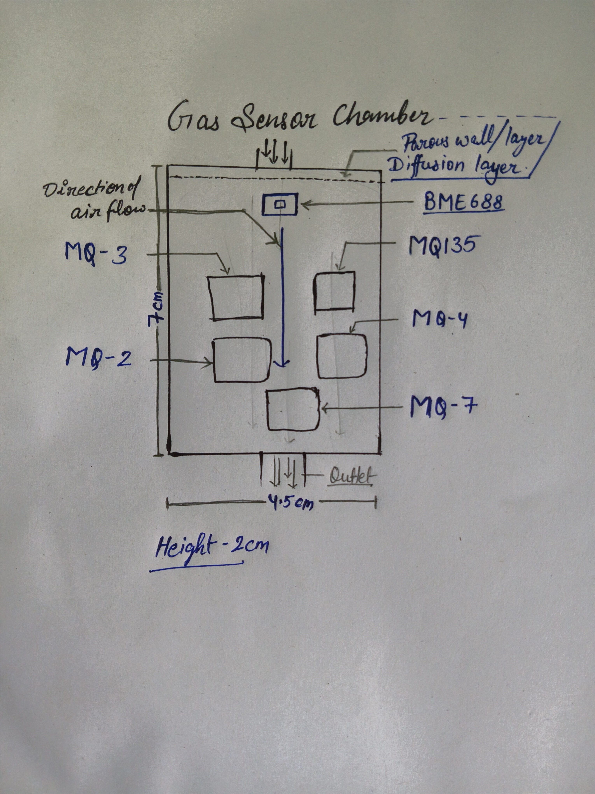
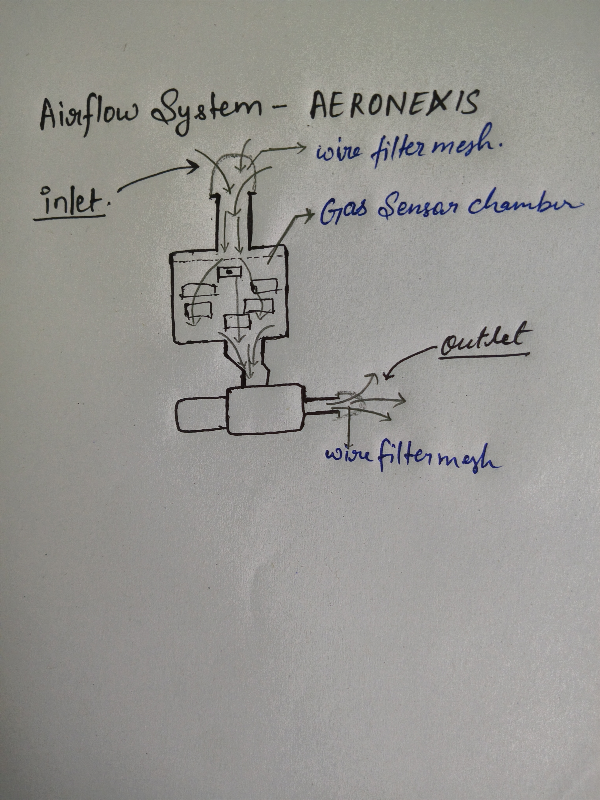

# AERONEXIS
An AI powered environmental perception through Computer Vision and Chemical Sensing

##--What Is AERONEXIS----------

AERONEXIS is an AI-powered environmental perception robot which uses Computer Vision and an Electronic Nose to interpret its surroundings.

The electronic nose uses an array of 6 different gas sensors to detect chemical compounds in the surrounding air and convert them into a set of signals unique to different kinds of odours.

Computer Vision uses a camera to observe the environment/surroundings and extract visual information.

##--Problem Statement----------

There are many tasks robots still can't help humans with because of a lack of a sense of smell.

This creates a huge gap between perception and reality.

(Tasks such as cooking guidance, food safety/quality detection, and many general tasks requiring olfactory receptors.)

##--Proposed Solution----------

We can detect odours based on their molecular interactions with metal oxides.
The surrounding air will be sucked through a filter mesh and then pumped into a chamber of gas sensors, circulating the air continuously and plotting the "sensor response vs. time" graph for each sensor in the array.
The array will return a specific graph for each sensor upon detecting an odour.
This will create a fingerprint of a specific odour.
We are plotting "sensor response vs. time" graph because Metal Oxide sensors take some time to reach a specific temperature to measure values accurately.
computer vision as Visual Perception is used to get more clues and assume/predict things better. 
Computer vision is required as a supporting sense because of the variability of different hardwares and sensor drift.

Point to be noted- different hardware will need some calibration.

##--How AERONEXIS works----------

AERONEXIS combines two senses to perceive the world:
Olfactory Perception & Visual Perception.

Olfactory Perception - The surrounding air is sucked through a filter mesh from an opening at the front of the robot. Then, it is pumped into the gas array chamber, and the air outlet opening is at the back of the body.

Immediately after this, the "sensor value vs. time" graph starts getting plotted, along with the humidity and temperature values obtained from the BME688 with its inbuilt humidity, temperature sensor.

Readings (graphs) from those six sensors, along with the humidity and temperature values, will then be processed through the matrices of an AI model loaded onto the NPU of the Radxa Cubie A7A in seconds.

Then, we will get the probabilities of what the smell could be.

Visual Perception - The servo-movable camera mounted on top of AERONEXIS will scan the environment (laboratory, kitchen, etc.) and then observe the specimen, gathering all the visual information (colour, texture, consistency, etc.).

We will then get the output of the Computer Vision model in a list of probabilities of what the specimen could be.

At Last - The probabilities from both perception models will be combined through Weighted Probability Fusion. The weights for both perception systems will vary over time, depending on the visibility of the specimen and the switch-on duration of the Metal Oxide sensors.

(The weight of the Olfactory Perception model is directly proportional to the duration it has been switched on because these sensors become more accurate as they heat up. But this is just to increase accuracy and will not even contribute a substantial part of weight and will be figured out for each sensor with time.)

After this whole process, the sensor data, visual data, along with the answer, will be saved in memory to increase accuracy through later training cycles/reinforcement learning.

##--System Architecture----------

Major hardware components and their configurations:

1. Radxa Cubie A7A (6GB Variant) – This will be the main SBC controlling AERONEXIS. It contains an NPU with 3 TOPS of computing power, which is helpful for such tasks.

2. Waveshare 3.5-inch HDMI LCD(E) (640 × 480) – Required for the user interface. It is connected through HDMI, with touch functionality provided through USB Type-C.

3. SD Card (32 GB) – To run the base OS.

4. External SSD (128 GB–500 GB) – To store information and run AI models. It interfaces through the onboard USB 3.1 port. I will be using a 500 GB SSD, as I already have one.

5. Heatsink – For cooling the Radxa.

6. Nose Array – A combination of six gas sensors (BME688, MQ-2, MQ-3, MQ-4, MQ-7, and MQ-135).

7. 2 × ADS1115 – Analog-to-digital converters for the GPIO interface of the Radxa Cubie A7A. They are placed between the SBC and the sensor array, receiving analog data from the sensor array and feeding it to the Radxa through I²C.

8. Radxa 8M IMX219 Camera Module – A camera module for computer vision, interfaced directly with the Radxa SBC through a CSI cable.

9. 3S 10Ah Battery Pack – With a maximum current output of 10 amperes, it will run the Radxa along with the metal oxide sensor heaters while maintaining sufficient power overhead.

10. 2 × MG90S Servo Motors – To rotate the camera and examine the environment. They will be controlled through PWM signals from the GPIOs of the Radxa Cubie A7A.

11. 300-Watt, 20-Amp Buck Converter – An adjustable buck converter to step down the voltage to 5 volts. The 300-watt and 20-amp ratings are the overhead limits; this project will require a maximum current of only 8 amperes.

12. Heater Control Circuit – The MQ-7 gas sensor requires a heater control circuit to heat its metal oxide sensing element.

13. DC Motor Air Compressor (Diaphragm Pump) – Blows air into the sensor array chamber after drawing air through a wire filter mesh.

14. Logic Level Shifter – A 3.3V-to-5V logic shifter to drive the control circuits for the MOSFETs and transistors.

15. IRLZ44N MOSFETs – To switch the high-current metal oxide sensor heaters on and off safely through the Radxa Cubie A7A.

16. 15-pin-to-31-pin FPC Cable – To connect the camera to the single-board computer.

17. 3S 40A BMS – With a maximum current rating of 40 amperes, along with a 12.6V CC/CV charger.

18. Gas Sensor Chamber Dimensions – 7 cm in length, 4.5 cm in breadth, and 2 cm in height. This provides enough space to fit all the sensors. PVC thickness: 2 mm.

19. AERONEXIS Dimensions – 10 inches in length, 6 inches in breadth, and 5 inches in height. This provides enough space to fit the Li-ion battery, SBC, and all other components, along with room for future changes or additions. PVC thickness: 2 mm, with internal supports.

20. INA219 – A voltage and current sensor to estimate battery backup based on power consumption and display the battery percentage. It works through I²C; therefore, there is no need for logic level shifting. Battery percentage estimation will be performed using coulomb counting.

21. 10A Fuse – A main fuse with a 10-ampere current rating to provide protection against short circuits.

(Power required everywhere is 5 volts. However, we are using an 11.1V 3S battery pack to account for voltage drops during battery discharge, as we are working with power-hungry and sensitive single-board computers that require a stable power supply.)

(Components are modular. No custom PCBs are required for the initial prototype. Perfboards will be used to assemble the nose sensor array.)

(We will create the outer enclosure/body of AERONEXIS by cutting the required dimensions out of PVC sheets. NO 3D PRINTERS USED.)

##--Software Architecture----------

--Operating System--

We will be using the official Radxa Debian Linux image (Debian 11 KDE R6). It gives a GUI, desktop interface, I²C interfacing, an excellent Python development platform, and OpenCV support.

--Sensor Processing--

Bosch BME688 is an I²C-based sensor which measures gas resistance changes, temperature, and humidity. It communicates directly with the Radxa Cubie A7A.

Other MQ-series sensors feed their data into analog-to-digital converters, and it's then recorded from the Radxa GPIO pins and timestamped.

After the data is timestamped, the raw data will go through filtering, preprocessing, and normalisation, which reduce noise and variations.

This processed data will then be converted into time-dependent sensor-response patterns and passed to the electronic nose model.

The camera records the specimen from different angles during this sensor-recording process and passes it on to the Computer Vision AI model running on the Radxa Cubie A7A.

--AI Models--

1. XGBoost – Learns complex relationships between different sensor readings. This AI model will learn different types of smells during training, detect them, and provide their probabilities.

XGBoost Documentation:
https://xgboost.readthedocs.io/

2. YOLO26n Laboratory Edition – This model recognises chemicals and laboratory apparatus.

YOLO26n Laboratory Edition Documentation:
https://docs.ultralytics.com/models/yolo26/

3. YOLO26n General Edition – This model recognises general objects in everyday life.

YOLO26n General Edition Documentation:
https://docs.ultralytics.com/models/yolo26/

--Data Fusion--

AERONEXIS uses Weighted Probability Fusion to combine outputs of its electronic nose and computer vision output.
Weights are assigned to both Electronic Nose and computer vision on the basis of their accuracy in different conditions.
The stored datasets are fetched and a mean value for a specific lighting, humid etc. conditions is derived to get the maximum accuracy.
For example- the weight of the Computer Vision model will be reduced when visibility is poor, while the weight of the Electronic Nose model will be decreased when the gas sensor readings are unstable.

##--Gas Sensor Chamber----------

This gas sensor chamber features a diffusion layer to spread the gas evenly. Bosch BME688 is a temperature and humidity sensor and the metal oxide sensors need to get heated to work therefore using both sensors in a single chamber can result in wrong data input and output (Garbage in Garbage out) therefore the BME688 is specifically installed at very beginning of the gas sensor chamber. 
MQ-7 sensor needs a circuit to drive the heating coil, so it is obvious that it generates more heat so I kept it near the outlet so it does not affect the other sensors data.

##--Airflow System----------

